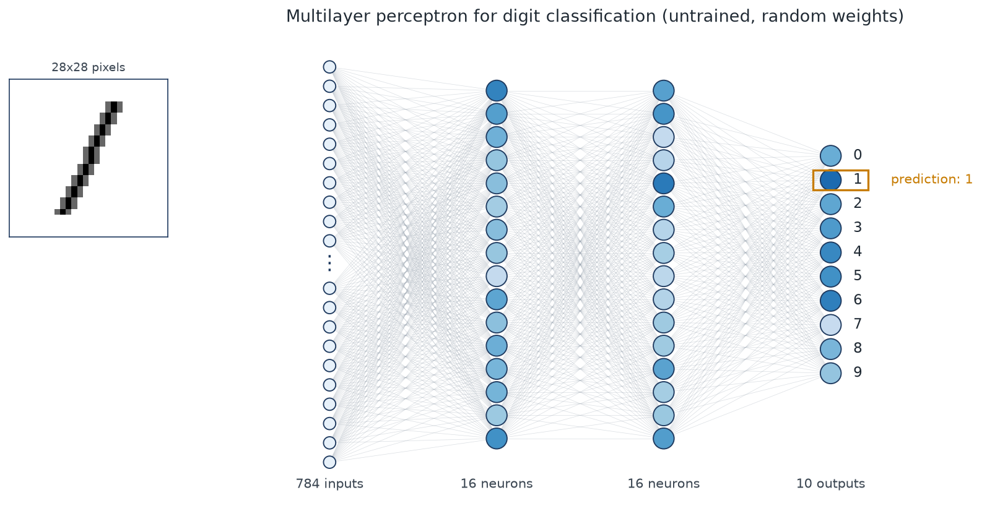

# Neural Networks 101

<!-- TODO: one-sentence pitch in your own words, e.g. what you built and why -->
A handwritten-digit classifier built from first principles in NumPy, with notebooks that explain
each step, from a single neuron to backpropagation and training on MNIST.



## Results

<!-- TODO: fill in once notebook 04 is done -->
| Model | Test accuracy | Notes |
|---|---|---|
| NumPy MLP (784-16-16-10, from scratch) | _tbd_ | |
| PyTorch equivalent | _tbd_ | |

<!-- TODO: add 2-3 best figures here: training curves, confusion matrix, first-layer weights -->

## Notebooks

| # | Notebook | What it covers |
|---|---|---|
| 01 | [Fundamentals](notebooks/01_fundamentals.ipynb) | Neurons, weights, biases and the sigmoid activation; a forward pass through an untrained network |
| 02 | MNIST exploration _(planned)_ | Loading the data, class balance, average digits, PCA |
| 03 | Backpropagation from scratch _(planned)_ | Deriving the gradients and checking them numerically |
| 04 | Training and evaluation _(planned)_ | Training loop, learning curves, confusion matrix, what the network learned |
| 05 | Comparison with PyTorch _(planned)_ | The same network in a framework, side by side |

## Project structure

```
├── notebooks/        # the write-up, one step per notebook
├── src/nn101/        # reusable code imported by the notebooks
│   ├── data.py
│   └── plotting.py
├── tests/            # pytest suite
└── images/           # figures saved by the notebooks
```

## Running it

Requires Python 3.12+.

```bash
git clone https://github.com/lawrencegatley/Neural_Networks_101.git
cd Neural_Networks_101
python -m venv .venv
source .venv/bin/activate
pip install -r requirements.txt

pytest                 # run the tests
# then open the notebooks/ folder in Jupyter, VS Code or DataSpell, using the .venv kernel
```

## Acknowledgements

The structure of the network and the intuition in notebook 01 follow 3Blue1Brown's
[Neural Networks](https://www.youtube.com/playlist?list=PLZHQObOWTQDN52m7Y21ePrTbvXkPaWVSg) series.
